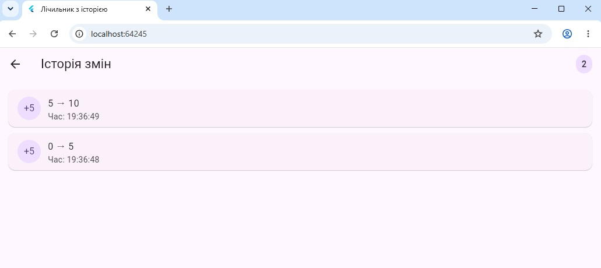
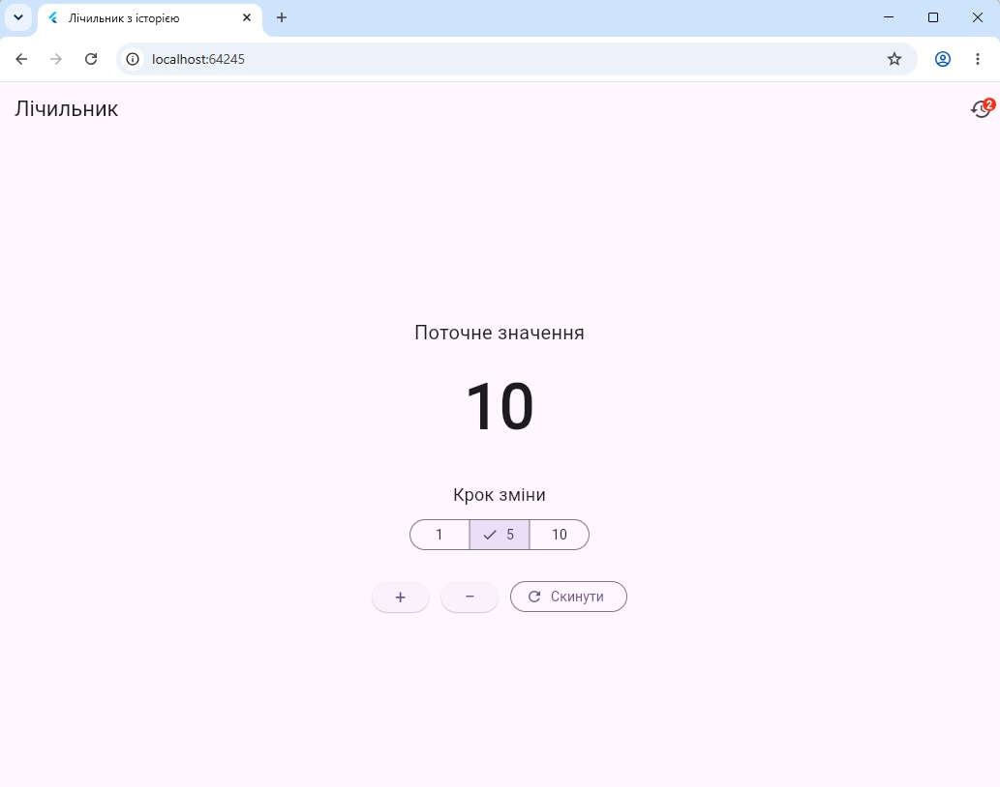
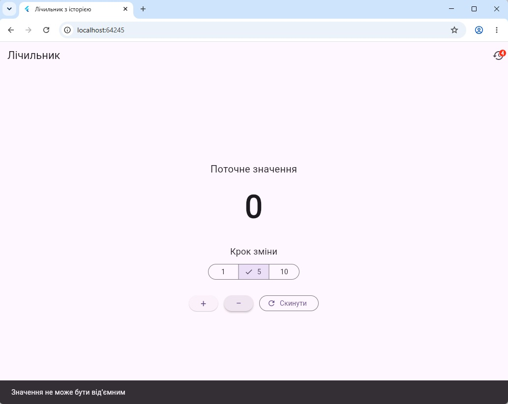

# Практична робота 6.1 — State Management у Flutter

**Студент:** Устич Максим  
**Група:** alk-43  
**Спеціальність:** 121 Інженерія програмного забезпечення  
**Варіант:** 1 — Лічильник з історією

## Опис проєкту

Flutter-застосунок демонструє керування станом без використання сторонніх пакетів.

У застосунку реалізовано:

- збільшення та зменшення значення лічильника;
- вибір кроку 1, 5 або 10;
- скидання значення до 0;
- заборону переходу до від’ємного значення;
- збереження історії змін;
- відображення часу, дії, попереднього та нового значення;
- badge з кількістю записів історії;
- очищення історії;
- точкові перебудови через `InheritedNotifier`.

## Етап 1 — Lifting State Up

Спільний стан лічильника та історії зберігався у батьківському віджеті та передавався дочірнім віджетам через конструктори і callbacks.

Git-тег:

`stage-1-lifting`

## Етап 2 — ChangeNotifier + InheritedNotifier

Спільний стан перенесено до класу `CounterState`, який розширює `ChangeNotifier`.

Для доступу до стану використовується `CounterScope` на основі `InheritedNotifier`.

Git-тег:

`stage-2-inherited`

## Розподіл стану

| Дані | Тип стану | Де зберігаються | Причина |
|---|---|---|---|
| Значення лічильника | App State | `CounterState` | Використовується різними віджетами |
| Історія змін | App State | `CounterState` | Використовується на двох екранах |
| Кількість записів історії | App State | `CounterState` | Відображається у badge |
| Вибраний крок 1/5/10 | Ephemeral State | `_CounterScreenState` | Потрібний лише на екрані лічильника |

## Перевірка точкових перебудов

Для перевірки перебудов використано `debugPrint()`.

Після першого запуску:

```text
build: CounterScreen
build: CounterValue
build: HistoryBadge
```

Після натискання кнопки `+`:

```text
build: CounterValue
build: HistoryBadge
```

`CounterScreen` повторно не перебудовується. Оновлюються лише віджети, які залежать від зміненого стану.

## Структура проєкту

```text
lib/
├── models/
│   └── history_entry.dart
├── screens/
│   ├── counter_screen.dart
│   └── history_screen.dart
├── state/
│   └── counter_state.dart
├── widgets/
│   ├── counter_value.dart
│   └── history_badge.dart
└── main.dart
```

## Запуск проєкту

```bash
flutter pub get
flutter analyze
flutter test
flutter run -d chrome
```

## Скріншоти

### Історія змін



### Головний екран лічильника



### Захист від від’ємного значення



## Використані технології

- Flutter
- Dart
- `StatefulWidget`
- `setState`
- `ChangeNotifier`
- `InheritedNotifier`
- `ListView.builder`
- Git

Сторонні пакети для State Management не використовувалися.